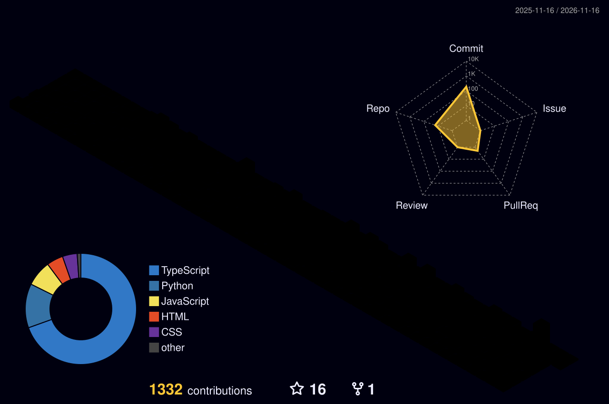

  

  I build AI coding agents, the evals that keep them honest, and the workflow automation around them.

  
  

## Currently Building

- Evaluation and QA systems for AI coding agents
- Code review and issue detection evals
- Codex-powered engineering workflows
- Agent memory for repeated developer tasks

## Agents and Evals

| Project | What it is |
|---|---|
| [**Understudy**](https://github.com/icecreamlun/understudy) | Codex as a forward-deployed engineer: it watches repetitive work, turns it into a skill, and runs it end-to-end under human sign-off |
| [**Axolotl**](https://github.com/icecreamlun/QA-Agents-Sentinel) | AI QA agent in VS Code that validates a pull request's main flows with real execution evidence and gives a merge recommendation |
| [**Codex Poker Bench**](https://github.com/icecreamlun/codex-poker-bench) | Live No-Limit Hold'em arena where frontier LLMs bluff and read each other, with public table talk and a private inner monologue |
| [**Auto-FDE**](https://github.com/icecreamlun/fde-agent) | Agent that learns repeated workflows and user preferences across sessions with HydraDB memory |
| [**Call Me Maybe**](https://github.com/icecreamlun/CallMeMaybe) | Voice agent that makes the phone call for you: cancel, dispute, and get the refund |

## 3D and Simulation

| Project | What it is |
|---|---|
| [**Argus**](https://github.com/icecreamlun/argus) | Post-earthquake copilot on a three.js model of San Francisco that corrects its physics against what the vision model sees and routes rescue units |
| [**Flytake**](https://github.com/icecreamlun/Flytake) | Drone cinematography simulator over Lake Tahoe's Emerald Bay, rebuilt in 3D from public lidar, imagery, and terrain data |

## More Builds

| Area | Projects |
|---|---|
| Agent products | [RentProof](https://github.com/icecreamlun/rentproof) · [Dream Walker](https://github.com/icecreamlun/Dream_Walker) · [Signal Buffet](https://github.com/icecreamlun/SuperMarket) · [Repocket](https://github.com/icecreamlun/Solo_GTM) · [Wealty](https://github.com/icecreamlun/Wealty) |
| Distributed systems | [Twitter Streaming Searching Microservices](https://github.com/icecreamlun/Twitter_Streaming_Searching_Microservices) |
| Security and systems | [Car-Cloud Communication over TLS](https://github.com/icecreamlun/Construction-of-Car-Cloud-Communication-Website-Based-on-TLS) |
| ML and perception | [BEVFormer](https://github.com/icecreamlun/BEVFormer) · [NYU Deep Learning](https://github.com/icecreamlun/NYU_Deep_Learning) · [LSTM Sentiment Classification](https://github.com/icecreamlun/LSTM_in_Text_Sentiment_Classification) |

## Contributions in 3D

  

## What I Care About

- Evals that measure whether agents produce useful engineering work, not just passing outputs
- Feedback loops for code review, issue detection, and production QA
- Agent workflows that remember user preferences and reduce repeated instruction
- Tools that make AI-assisted engineering more observable, reliable, and reviewable
